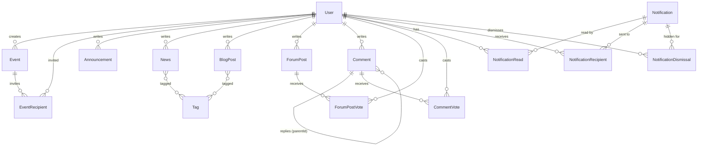

# Database Schema

Source of truth: [`api/prisma/schema.prisma`](../api/prisma/schema.prisma). Database: SQLite (`DATABASE_URL`, default `file:./dev.db`).

## Conventions

- **IDs:** every model has its own `id`, a UUID string generated by Prisma (`@default(uuid())`). News, announcements, blog posts, events, forum posts, and comments are all addressed by these IDs in the API (e.g. `GET /api/news/:id`). The database stores them as plain strings and does not enforce UUID format.
- **Timestamps:** `createdAt` is set on insert; `updatedAt` is maintained automatically (except on `Notification`, `NotificationRead`, and `NotificationDismissal`, which use `createdAt` / `readAt` / `dismissedAt`).
- **Tags:** news and blog use many-to-many `Tag` relations, presented as string arrays.
- **Uploads:** `coverImageUrl` / `avatarUrl` store service-owned paths or external URLs, not binary data. API responses present absolute image URLs.

## Enums

| Enum | Values |
|------|--------|
| `Role` | `SUPERUSER`, `ADMIN`, `USER` |
| `UserStatus` | `ACTIVE`, `INACTIVE`, `PENDING`, `SUSPENDED`, `DELETED` |
| `NotificationAudience` | `GLOBAL`, `DIRECTED` |
| `EventAudience` | `GLOBAL`, `SELECTED` |

## Entity relationships



`Notification` and `Comment` point at source content loosely through `resourceType` + `resourceId` (no foreign key). `GLOBAL` notifications have no recipient rows; `DIRECTED` ones list intended users in `NotificationRecipient`. Per-user dismissals hide a notification from one inbox only. `SELECTED` events list invitees in `EventRecipient` (creator always included); `GLOBAL` events have no recipient rows.

## Models

### User

| Field | Type | Notes |
|-------|------|-------|
| `id` | String | PK, UUID |
| `username` | String | Unique |
| `fullName` | String | |
| `email` | String? | Optional; unique when provided |
| `passwordHash` | String | Never returned by the API |
| `role` | Role | Default `USER` |
| `status` | UserStatus | Default `PENDING` |
| `avatarUrl` | String? | Custom avatar; null uses the animal default in API responses |
| `createdAt`, `updatedAt` | DateTime | |

Missing email is stored as SQL `NULL` and returned as `email: null`, allowing
multiple accounts without email while retaining uniqueness for supplied addresses.
Username is required and is the default login identifier.

### Event

| Field | Type | Notes |
|-------|------|-------|
| `id` | String | PK, UUID |
| `title`, `description`, `location` | String | |
| `startAt`, `endAt` | DateTime | |
| `coverImageUrl` | String? | |
| `audience` | EventAudience | `GLOBAL` (default) or `SELECTED` |
| `createdById` | String | FK → `User.id` |
| `createdAt`, `updatedAt` | DateTime | |

### EventRecipient

| Field | Type | Notes |
|-------|------|-------|
| `id` | String | PK, UUID |
| `eventId` | String | FK → `Event.id` (cascade delete) |
| `userId` | String | FK → `User.id` |
| | | Unique on `(eventId, userId)` |

Used only when `Event.audience` is `SELECTED`. Visibility and create notifications are limited to these users (creator always present).

### Announcement

| Field | Type | Notes |
|-------|------|-------|
| `id` | String | PK, UUID |
| `title`, `description` | String | |
| `authorId` | String | FK → `User.id` |
| `createdAt`, `updatedAt` | DateTime | |

### News and BlogPost

Both models share the same shape.

| Field | Type | Notes |
|-------|------|-------|
| `id` | String | PK, UUID |
| `title` | String | |
| `content` | String | Markdown |
| `tags` | Tag[] | Many-to-many; unique tag names |
| `coverImageUrl` | String? | |
| `authorId` | String | FK → `User.id` |
| `createdAt`, `updatedAt` | DateTime | |

### ForumPost

| Field | Type | Notes |
|-------|------|-------|
| `id` | String | PK, UUID |
| `title`, `content` | String | `content` is Markdown |
| `score` | Int | Denormalized sum of votes, default `0` |
| `authorId` | String | FK → `User.id` |
| `createdAt`, `updatedAt` | DateTime | |

### Comment

| Field | Type | Notes |
|-------|------|-------|
| `id` | String | PK, UUID |
| `content` | String | Markdown |
| `score` | Int | Denormalized sum of votes, default `0` |
| `resourceType` | String | `announcement` \| `event` \| `news` \| `blog` \| `forum` |
| `resourceId` | String | Target content id (no FK) |
| `authorId` | String | FK → `User.id` |
| `parentId` | String? | FK → `Comment.id` for replies, cascade delete |
| `createdAt`, `updatedAt` | DateTime | |

Indexed on `(resourceType, resourceId)`. One-level replies enforced in the service.

### ForumPostVote and CommentVote

| Field | Type | Notes |
|-------|------|-------|
| `id` | String | PK, UUID |
| `value` | Int | `1` or `-1` |
| `userId` | String | FK → `User.id`, cascade delete |
| `postId` / `commentId` | String | FK → forum post or comment, cascade delete |
| `createdAt`, `updatedAt` | DateTime | |

Unique on `(userId, postId)` or `(userId, commentId)`: one vote per user per target.

### Notification

| Field | Type | Notes |
|-------|------|-------|
| `id` | String | PK, UUID |
| `audience` | Enum | `GLOBAL` (everyone) or `DIRECTED` (specific recipients) |
| `type`, `title`, `body` | String | |
| `resourceType`, `resourceId` | String | Points at the source record (no FK) |
| `createdAt` | DateTime | |

### NotificationRecipient

| Field | Type | Notes |
|-------|------|-------|
| `id` | String | PK, UUID |
| `notificationId` | String | FK → `Notification.id`, cascade delete |
| `userId` | String | FK → `User.id`, cascade delete |

Unique on `(notificationId, userId)`. Used when `audience` is `DIRECTED`.

### NotificationRead

| Field | Type | Notes |
|-------|------|-------|
| `id` | String | PK, UUID |
| `userId` | String | FK → `User.id` |
| `notificationId` | String | FK → `Notification.id`, cascade delete |
| `readAt` | DateTime | |

Unique on `(userId, notificationId)`.

### NotificationDismissal

| Field | Type | Notes |
|-------|------|-------|
| `id` | String | PK, UUID |
| `userId` | String | FK → `User.id`, cascade delete |
| `notificationId` | String | FK → `Notification.id`, cascade delete |
| `dismissedAt` | DateTime | |

Unique on `(userId, notificationId)`. Hides a notification from one user's inbox without affecting others.

## Working with the schema

```bash
cd api
npx prisma migrate dev     # apply migrations / create a new one after editing schema.prisma
npx prisma studio          # browse data in a UI
```

For the HTTP view of these models, see the generated [`openapi/openapi.json`](../openapi/openapi.json) or Swagger at `/docs`.

### Tag

`Tag` has a UUID `id` and unique `name`. News and BlogPost have independent many-to-many relations to tags. Filtering uses exact names.
